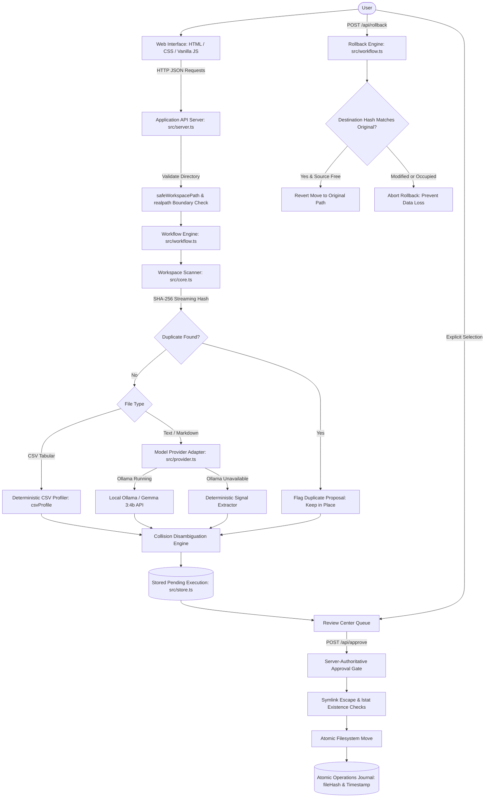

# SlothDesk AI
### Let your AI handle the busywork.

[](./LICENSE)
[](https://nodejs.org/)
[](https://www.typescriptlang.org/)
[](./src/tests/)
[](#privacy-and-security-model)

SlothDesk AI is a local-first productivity automation workbench. It scans a folder you explicitly designate, inventories documents and tabular files, flags exact cryptographic duplicates, extracts actionable tasks and decisions, profiles CSV data without cloud dependencies, and prepares category organization proposals. Nothing moves on your filesystem until you inspect and approve individual operations in the Review Center.

---

## Table of Contents

- [Overview](#overview)
- [Core Features](#core-features)
- [Five-Minute Reproducible Demo](#five-minute-reproducible-demo)
- [Architecture](#architecture)
- [Verified Technology Stack](#verified-technology-stack)
- [Prerequisites](#prerequisites)
- [Installation and Quick Start](#installation-and-quick-start)
- [Ollama and Gemma Setup](#ollama-and-gemma-setup)
- [End-to-End Usage Instructions](#end-to-end-usage-instructions)
- [Privacy and Security Model](#privacy-and-security-model)
- [Local Mode vs. Hosted Mode](#local-mode-vs-hosted-mode)
- [Tests and Development Workflow](#tests-and-development-workflow)
- [Render Deployment Instructions](#render-deployment-instructions)
- [Honest Roadmap and Limitations](#honest-roadmap-and-limitations)
- [Contribution Guidelines](#contribution-guidelines)
- [License and Acknowledgments](#license-and-acknowledgments)

---

## Overview

Modern knowledge workers frequently deal with disorganized folders filled with meeting notes, project briefs, exported datasets, and duplicate files. Traditional automation scripts lack context, while commercial cloud AI platforms require uploading private desktop files to external servers.

SlothDesk AI was engineered to bridge this gap with a **calm, inspectable, local-first model**:

1. **Explicit authorization:** The application only accesses the exact directory path you enter.
2. **Deterministic safety:** Cryptographic deduplication, schema validation, path traversal defense, and tabular profiling operate natively on your machine with zero cloud dependence.
3. **Optional open-weight intelligence:** When Ollama is running locally, Gemma summarizes text and extracts tasks on-device. When unavailable, deterministic fallback takes over automatically.
4. **Human-in-the-loop review:** Model predictions produce proposals, never automatic file changes. You approve exactly what moves, and every completed operation is journaled and reversible.

---

## Core Features

| Feature | Implementation | Benefit |
|---|---|---|
| **Cryptographic Deduplication** | Streaming SHA-256 hash calculation across all scanned files. | Immediately detects identical files even if filenames or extensions differ, preventing redundant storage. |
| **Deterministic CSV Profiling** | Pure TypeScript parser calculating row counts, columns, null rates, and inferred data types. | Delivers immediate tabular diagnostics without passing data to an LLM or external API. |
| **Open-Weight Text Analysis** | Local Ollama adapter calling `gemma3:4b` with schema-constrained JSON extraction. | Summarizes notes and extracts tasks and deadlines on your own machine. |
| **Resilient Deterministic Fallback** | Regular expression and structural heuristics extracting action items and dates. | Guarantees full workbench utility even when Ollama is offline or on machines without GPU acceleration. |
| **Collision-Safe Proposals** | Filename disambiguation (`name-1.ext`, `name-2.ext`) and parent segment tracking. | Prevents partial move failures and file clobbering when identical file names exist in distinct folders. |
| **Server-Authoritative Approval** | UUID-keyed execution records loaded strictly from the local server store. | Prevents client parameter forgery, path injection, or replay of completed operations. |
| **Tamper-Resistant Rollback** | Pre-move SHA-256 hash tracking and destination existence verification via `lstat`. | Restores original directory layouts while refusing to overwrite newly created or modified files. |
| **Crash-Resilient Persistence** | Atomic temporary-file creation and POSIX rename writes for `.data/` records. | Protects history records and operation journals against process interrupts or power losses. |

---

## Five-Minute Reproducible Demo

The repository includes a synthetic test directory at `demo-workspace/` containing realistic notes, meeting decisions, a duplicate file, and a sample sales dataset.

### 1. Copy the Demo Files

Create a temporary working copy to keep the repository files clean:

```bash
cp -r demo-workspace /tmp/slothdesk-demo
```

### 2. Launch the Application

```bash
npm run build
npm start
```

Open `http://localhost:3147` in your browser.

### 3. Run the Dry-Run Scan

1. Select the **Workspace** tab.
2. Enter `/tmp/slothdesk-demo` into the **Authorized folder path** input.
3. Click **Run dry-run scan**.
4. The dashboard displays:
   - **4 files inventoried.**
   - **1 duplicate flagged:** `meeting-notes.md` is identified as an exact SHA-256 duplicate of `duplicate-notes.txt`.
   - **3 actionable tasks and decisions extracted.**
   - **Net time savings calculated** from actual workflow run duration.

### 4. Inspect CSV Profiling

Switch to the **CSV Lab** tab to examine row counts, duplicate rows, missing fields, and column types for `sales.csv`.

### 5. Review and Approve Proposals

1. Switch to the **Review Center** tab.
2. Review the generated reorganization proposals (`actionable/duplicate-notes.txt`, `actionable/project-notes.txt`, `dataset/sales.csv`).
3. Click **Approve selected operations**.
4. Check your terminal or file manager: the files in `/tmp/slothdesk-demo` are relocated cleanly to their categorized folders.

### 6. Execute Safe Rollback

1. In the **Review Center**, click **Rollback completed operations**.
2. Check `/tmp/slothdesk-demo`: every moved file is returned to its original path.
3. View the **Activity & Settings** tab to confirm the recorded execution and rollback timestamp.

---

## Architecture

The diagram below reflects the actual request flow and safety boundaries enforced in the codebase:



---

## Verified Technology Stack

| Component | Technology | Rationale |
|---|---|---|
| **Runtime** | Node.js (>=20 LTS) | Native `fetch`, `crypto`, `fs/promises`, and built-in test runner. |
| **Language** | TypeScript 5.7 | Strict type safety, modern ES modules, and zero runtime overhead. |
| **Testing** | Node.js Test Runner (`node --test`) | Zero-dependency native test harness with sub-millisecond execution. |
| **Styling** | Vanilla CSS3 | Custom brand tokens (`--cream`, `--ink`, `--orange`), zero build dependencies. |
| **Frontend** | Vanilla JavaScript (ES2022) | Single-file responsive interface with zero framework bloat. |
| **Inference** | Ollama HTTP API (Local) | Standard interface for open-weight models (`gemma3:4b`). |
| **Persistence** | Atomic JSON File Store | Self-contained, portable, zero-setup storage without external database services. |

---

## Prerequisites

- **Node.js:** Version 20.0.0 or higher.
- **npm:** Version 10.0.0 or higher.
- **Operating System:** macOS, Linux, or Windows (WSL recommended for Windows).
- **Optional for AI inference:** [Ollama](https://ollama.com) installed locally with `gemma3:4b` pulled.

---

## Installation and Quick Start

### 1. Clone the Repository

```bash
git clone https://github.com/shauryatiwari/SlothDesk-Ai.git
cd SlothDesk-Ai
```

### 2. Install Dependencies

```bash
npm install
```

### 3. Run Tests and Build

```bash
npm test
npm run build
```

### 4. Start the Local Server

```bash
npm start
```

Navigate to `http://localhost:3147` in your web browser.

---

## Ollama and Gemma Setup

SlothDesk AI is preconfigured to use the open-weight **Gemma 3 (4B)** model via Ollama.

### 1. Install Ollama

Download and install Ollama from [ollama.com](https://ollama.com).

### 2. Pull the Configured Model

```bash
ollama pull gemma3:4b
```

### 3. Start the Ollama Service

```bash
ollama serve
```

### 4. Verify Local Connection

Check the status badge in the SlothDesk AI navigation bar:
- If Ollama is active with the model present: **`READY · Local model is ready.`**
- If Ollama is stopped or unavailable: **`FALLBACK · Ollama is unavailable; deterministic local analysis is active.`**

The application functions completely under fallback mode without throwing runtime errors or blocking document processing.

---

## End-to-End Usage Instructions

### 1. Authorizing a Workspace

SlothDesk AI will never scan your whole drive or default directories. In the **Workspace** tab, provide an absolute or relative path to the specific directory you wish to organize.

### 2. Inspecting the Inventory

Click **Run dry-run scan**. The engine will:
- Parse all supported files up to `MAX_FILE_BYTES` (default 1 MB).
- Group exact cryptographic duplicates.
- Extract task checklists (`TODO:`, `Task:`) and decisions.
- Profile any CSV tables.
- Compute estimated net time saved (`manual estimate - processing duration - review estimate`).

### 3. Selecting and Approving Proposals

Switch to the **Review Center**:
- Proposals are presented as unchecked or checked review items.
- Duplicate files default to keep-in-place review proposals so no data is discarded.
- Select the proposals you agree with and click **Approve selected operations**.
- The server performs atomic moves with collision avoidance.

### 4. Reversing Moves

If you wish to restore the workspace to its prior arrangement:
- Click **Rollback completed operations** in the Review Center.
- The server verifies each file's integrity and returns it to its original path.

---

## Privacy and Security Model

SlothDesk AI was built around strict defensive engineering principles:

1. **Workspace Boundary Confinement:** All file access uses `safeWorkspacePath` and `fs.realpath` resolution. Path traversal sequences (`../`, absolute path escapes, null bytes) are blocked immediately.
2. **Server-Authoritative Operations:** Client browsers receive execution IDs and proposal IDs. The server validates every approval against its own persisted records. Client-injected paths or tampered IDs are rejected.
3. **Symlink Escape Defense:** Symlinks pointing outside the authorized workspace are rejected during scans and operation approvals.
4. **Collision Disambiguation:** Proposals disambiguate duplicate file names (`notes-1.txt`, `notes-2.txt`) across folders before execution, preventing accidental overwrites.
5. **Rollback Integrity Verification:** Rollback compares the file's current SHA-256 hash against the hash recorded at move time. If a user edited the file in its new location, or if a new file occupies the original path, rollback aborts to prevent data loss.
6. **Atomic Persistence:** All execution records and operation journals are saved via atomic temporary file writes followed by POSIX renames, preventing corrupt JSON on unexpected termination.
7. **Safe Static Server:** The internal HTTP server confines static assets strictly to `public/`, blocks sibling directory escapes, rejects null bytes, and returns clean 404 responses without leaking system path details.

---

## Local Mode vs. Hosted Mode

| Aspect | Local Mode (`HOSTED_MODE=false`) | Hosted Mode (`HOSTED_MODE=true`) |
|---|---|---|
| **Primary Use Case** | Personal desktop and local developer workbench. | Cloud-deployed demonstration environments (e.g. Render). |
| **Workspace Scanning** | Allowed only for explicitly entered local folders. | **Strictly blocked (HTTP 403).** |
| **Operation Approvals** | Allowed for authorized local executions. | **Strictly blocked (HTTP 403).** |
| **Rollback** | Allowed for local executions. | **Strictly blocked (HTTP 403).** |
| **Static UI & Health** | Enabled (`/`, `/api/health`, `/api/executions`). | Enabled (`/`, `/api/health`, `/api/executions`). |
| **Security Guarantee** | Server operations confined to user workspace. | Server filesystem cannot be scanned or altered by public web users. |

To enforce hosted mode, set `HOSTED_MODE=true` in your environment.

---

## Tests and Development Workflow

The test suite runs using Node's native test runner with TypeScript compilation:

```bash
# Run complete test suite (24 automated tests)
npm test

# Run build only
npm run build

# Run in development mode with live reload
npm run dev
```

### Test Coverage Highlights

The test suite validates:
- `core.test.ts`: File classification, boundary escape rejection, SHA-256 deduplication, CSV statistics, approval journal lifecycle.
- `adversarial.test.ts`: Path traversal, symlink escapes, rollback overwrite safety, post-move modification detection, proposal forgery rejection, replay prevention, collision disambiguation, broken symlink clobber prevention, partial move recovery, persistence across process restarts, file size limits.
- `provider.test.ts`: Model provider health detection, structured JSON response extraction, graceful fallback on endpoint failure, graceful fallback on invalid schema.
- `server.test.ts`: Health check endpoint, execution list endpoint, hosted-mode filesystem rejection, payload validation, static file serving security.

---

## Render Deployment Instructions

The repository includes a ready-to-use Render Blueprint template in `render.yaml`.

### 1. Blueprint Configuration

```yaml
services:
  - type: web
    name: slothdesk-ai
    runtime: node
    buildCommand: npm ci && npm run build
    startCommand: npm start
    healthCheckPath: /api/health
    envVars:
      - key: NODE_VERSION
        value: "20"
      - key: HOSTED_MODE
        value: "true"
      - key: OLLAMA_BASE_URL
        value: "http://127.0.0.1:11434"
      - key: OLLAMA_MODEL
        value: "gemma3:4b"
```

### 2. Deployment Steps

1. Fork or push the repository to GitHub.
2. In the Render Dashboard, select **New +** > **Blueprint**.
3. Connect the repository. Render will automatically detect `render.yaml`.
4. Click **Apply**.
5. Once deployed, the service responds to `/api/health` with HTTP 200.

---

## Honest Roadmap and Limitations

Transparency regarding current technical boundaries:

- **Local Inference Environment:** Real Gemma 3:4b inference requires a local Ollama instance with model weights pulled. On machines without Ollama running, the application operates on verified deterministic fallback.
- **Hosted Filesystem Scanning:** Hosted mode intentionally rejects `/api/cleanup`, `/api/approve`, and `/api/rollback` to protect the host server. A future multi-user release will introduce isolated per-user upload sandboxes.
- **File Format Scope:** Supported formats are TXT, Markdown, CSV, and JSON. PDF parsing, DOCX extraction, and image OCR are planned for subsequent iterations.
- **Data Persistence:** The current local store writes to `.data/` using atomic JSON. Persistent disk attachments or an embedded SQLite adapter are planned for hosted durability.
- **TabPFN Integration:** CSV profiling is deterministic. An optional TabPFN adapter remains in research to ensure proper Python isolation and licensing compliance prior to inclusion.

---

## Contribution Guidelines

Contributions are welcome. Please adhere to these guidelines:

1. Maintain TypeScript strict mode with zero type errors.
2. All new file operations must include path traversal, symlink escape, and rollback safety checks.
3. Write clean, self-documenting code. Do not include extraneous inline code comments.
4. Run `npm test` and ensure all test suites pass before submitting pull requests.
5. Never commit private credentials, personal file paths, or `.data/` contents.

For detailed guidelines, refer to [CONTRIBUTING.md](./CONTRIBUTING.md).

---

## License and Acknowledgments

- **License:** Released under the [MIT License](./LICENSE).
- **Model:** Compatible with [Google Gemma](https://ai.google.dev/gemma) open weights via [Ollama](https://ollama.com).
- **Security:** Built and verified for the Hacktoberfest Open-Source AI Challenge.
