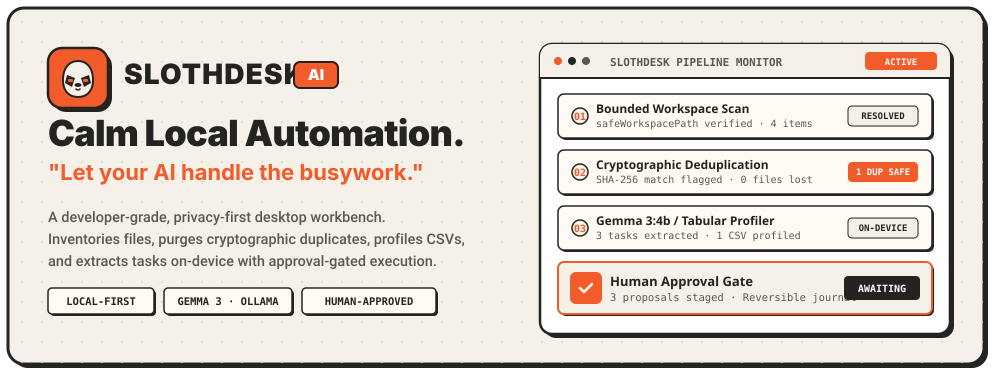
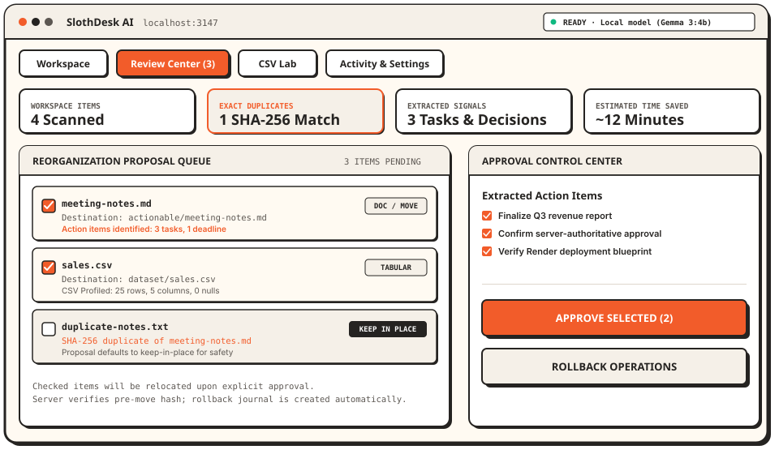
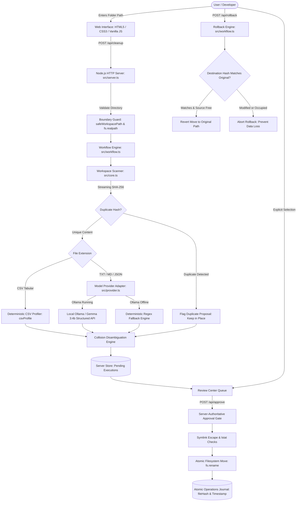
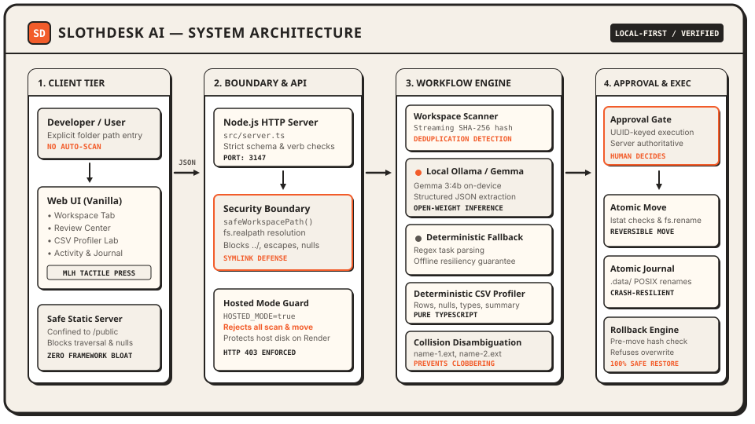

<div align="center">

<a href="#overview">
  
</a>

<p align="center">
  <strong>Let your AI handle the busywork.</strong><br />
  <em>A local-first, privacy-grade desktop automation workbench powered by open-weight AI.</em>
</p>

<p align="center">
  <a href="./LICENSE"></a>
  <a href="https://nodejs.org/">=20 LTS" /></a>
  <a href="https://www.typescriptlang.org/"></a>
  <a href="./src/tests/"></a>
  <a href="https://ollama.com"></a>
  <a href="#security-model"></a>
</p>

<p align="center">
  <a href="#core-features"><strong>Explore Features</strong></a> •
  <a href="#installation-and-quick-start"><strong>Quick Start</strong></a> •
  <a href="#five-minute-reproducible-demo"><strong>Live Demo</strong></a> •
  <a href="#architecture"><strong>Architecture</strong></a> •
  <a href="#security-model"><strong>Security Model</strong></a> •
  <a href="#contribution-guide"><strong>Contributing</strong></a>
</p>

<br />

<a href="#architecture">
  
</a>

</div>

---

## Table of Contents

- [Overview](#overview)
- [Design Philosophy](#design-philosophy)
- [Core Features](#core-features)
- [Application Preview](#application-preview)
- [How the Application Works](#how-the-application-works)
- [Architecture](#architecture)
- [Verified Technology Stack](#verified-technology-stack)
- [Prerequisites](#prerequisites)
- [Installation and Quick Start](#installation-and-quick-start)
- [Ollama and Gemma Setup](#ollama-and-gemma-setup)
- [Five-Minute Reproducible Demo](#five-minute-reproducible-demo)
- [Security Model](#security-model)
- [Local Execution versus Hosted Deployment](#local-execution-versus-hosted-deployment)
- [Tests and Development](#tests-and-development)
- [Render Deployment](#render-deployment)
- [Roadmap and Limitations](#roadmap-and-limitations)
- [Contribution Guide](#contribution-guide)
- [License and Acknowledgments](#license-and-acknowledgments)

---

## Overview

Modern knowledge workers and engineers regularly contend with cluttered project folders full of exported meeting notes, unstructured documents, untyped CSV tables, and duplicate files. Conventional shell scripts lack semantic awareness, while hosted cloud AI utilities demand transmitting private desktop documents across external servers.

**SlothDesk AI** solves this with a **calm, inspectable, local-first automation workbench**:

1. **Zero Unsolicited File Operations:** The server inspects only the explicit directory path you specify. No background daemon traverses personal directories or cloud drives.
2. **Deterministic Cryptographic Grounding:** Exact duplicate detection via streaming SHA-256 hashes, path traversal defense, and tabular profiling operate purely on your machine with zero cloud dependence.
3. **Open-Weight Intelligence On-Device:** When [Ollama](https://ollama.com) is running locally, Gemma summarizes text and extracts structured action items on your machine. When offline, an automated deterministic fallback takes over instantly.
4. **Human-in-the-Loop Review:** Model outputs produce proposals, never direct filesystem alterations. You inspect, select, and authorize every move in the Review Center, with atomic journals and one-click rollback.

---

## Design Philosophy

SlothDesk AI couples retro-futuristic developer tooling aesthetics with defensive software engineering:

- **Warm Cream & Charcoal Palette:** High-contrast editorial presentation (`#f5f0e8` cream, `#252321` ink) with vivid orange action accents (`#f25c2a`).
- **Tactile Neo-Brutalist Affordances:** Strong 2px borders, visible 4px hard-offset shadows, and physical button-press responses engineered for high confidence during file operations.
- **Zero Framework Bloat:** Fast, lightweight frontend running vanilla HTML5, CSS3 tokens, and modern ES modules with zero bundle lag.
- **Transparent Failure Modes:** Clear model status indicators (`READY` vs `FALLBACK`) with deterministic reliability when GPU inference is unavailable.

---

## Core Features

<div align="center">

| Icon | Capability | Technical Implementation | Practical Benefit |
| :---: | :--- | :--- | :--- |
|  | **Local-First Processing** | Natively bound Node.js HTTP server reading only user-designated paths via `safeWorkspacePath`. | Absolute privacy. Zero documents, credentials, or filesystem paths ever leave your local machine. |
|  | **Open-Weight AI** | Local Ollama adapter querying `gemma3:4b` with schema-enforced structured JSON output. | High-quality task and decision extraction without third-party API bills, tracking, or rate limits. |
|  | **SHA-256 Duplicate Detection** | Streaming cryptographic hashing over all scanned files up to configurable byte boundaries. | Identifies identical files regardless of file name or location; preserves duplicates safely in place. |
|  | **Action Item Extraction** | Joint parser extracting `TODO:` items, deadlines, dates, and organizational categories. | Transforms unstructured meeting dumps and project briefs into structured, actionable checklists. |
|  | **Deterministic CSV Profiling** | Pure TypeScript parser calculating row counts, columns, null rates, and inferred data types. | Delivers immediate tabular diagnostics without passing data to an LLM or external API. |
|  | **Approval-Gated Execution** | Server-authoritative UUID execution store verifying proposal IDs before executing filesystem operations. | Eliminates rogue file renames and client parameter forgery; you retain total command over moves. |
|  | **Tamper-Resistant Rollback** | Pre-move SHA-256 verification and destination existence checks before reversing file relocations. | Safely restores original file layouts while refusing to overwrite newly created or modified files. |
|  | **Defensive Workspace Bounds** | Canonical `fs.realpath` resolution blocking `../`, absolute escapes, symlink escapes, and null bytes. | Hardens local execution against accidental or malicious traversal outside the designated folder. |

</div>

---

## Application Preview

Below is an architectural vector schematic of the SlothDesk AI workbench interface:

<div align="center">
  
  <p><em>Abstract UI Schematic: The 4-tab workbench showcasing scanned inventory metrics, cryptographic deduplication, on-device signal extraction, and the human-in-the-loop review queue.</em></p>
</div>

---

## How the Application Works

```
┌─────────────────┐      ┌─────────────────────────┐      ┌─────────────────────────┐
│  1. Ingestion   │ ───► │  2. Cryptographic Hash  │ ───► │   3. Local Extraction   │
│ User designates │      │ Streaming SHA-256 check │      │ Gemma 3:4b (or fallback)│
│ specific folder │      │ flags exact duplicates  │      │ profiles tasks & CSVs   │
└─────────────────┘      └─────────────────────────┘      └─────────────────────────┘
                                                                       │
                                                                       ▼
┌─────────────────┐      ┌─────────────────────────┐      ┌─────────────────────────┐
│ 6. Safe Journal │ ◄─── │  5. Atomic Relocation   │ ◄─── │  4. Review & Approval   │
│ Atomic POSIX log│      │ Collision-safe moves to │      │ Server-authoritative    │
│ enables rollback│      │ categorized subfolders  │      │ approval gate in web UI │
└─────────────────┘      └─────────────────────────┘      └─────────────────────────┘
```

1. **Explicit Designation:** The user inputs a specific folder path (`/path/to/folder`). Path traversal sequences (`../`, null bytes, symlink targets outside root) are resolved and blocked.
2. **Cryptographic Deduplication:** The core scanner computes streaming SHA-256 hashes across files. Exact matches are flagged with keep-in-place proposals so redundant files are not lost.
3. **Dual-Track Signal Extraction:**
   - **Tabular Data:** CSV files route to the deterministic CSV profiler for row counts, columns, null percentages, and column typing.
   - **Text & Notes:** Text and Markdown documents route to the model provider. If Ollama is active, `gemma3:4b` performs schema-constrained extraction; if offline, deterministic heuristics extract action items and dates.
4. **Collision-Safe Proposals:** Proposed destinations are sanitized. If multiple files collide on a destination name, numeric disambiguation (`name-1.ext`, `name-2.ext`) prevents clobbering.
5. **Human Inspection & Approval:** Proposals are stored under a server-authoritative UUID. The user visits the **Review Center**, verifies the operations, and clicks **Approve selected operations**.
6. **Reversible Execution:** Approved files are relocated atomically via `fs.rename`. The pre-move hash, timestamp, and paths are committed to `.data/` using atomic temporary writes and POSIX renames.

---

## Architecture

The following diagram details the actual request lifecycle, component interactions, and security boundaries implemented in the codebase:



### Static Architecture Diagram

A matching vector representation of the multi-tier architecture is maintained in the repository:

<div align="center">
  
</div>

> **Important Deployment Notice:** When deployed to hosted cloud environments (e.g., Render), SlothDesk AI runs with `HOSTED_MODE=true`. In hosted mode, all filesystem scanning and move endpoints are blocked (HTTP 403) to prevent cloud host exploitation. Hosted Render instances cannot access, scan, or modify files on your local computer.

---

## Verified Technology Stack

| Layer | Technology | Version | Architectural Role |
| :--- | :--- | :--- | :--- |
| **Runtime** | Node.js | >=20 LTS (Tested on 20 & 24) | Native `fetch`, `node:crypto`, `node:fs/promises`, native test runner. |
| **Language** | TypeScript | 5.7+ | Strict type checking, zero runtime overhead, ES module emission. |
| **Testing** | Node.js Test Runner | Native (`node --test`) | Sub-second execution, zero external testing dependencies. |
| **Styling** | Vanilla CSS3 | Standard | Custom neo-brutalist tokens (`--cream`, `--ink`, `--orange`), responsive grid. |
| **Frontend** | Vanilla JavaScript | ES2022 | Single-file reactive interface without framework overhead. |
| **Inference** | Ollama | HTTP API | Open-weight on-device language models (`gemma3:4b`). |
| **Fallback** | Heuristic Engine | TypeScript Native | Deterministic task extraction and date parsing when Ollama is offline. |
| **Storage** | Atomic JSON Store | POSIX File API | Crash-resilient state records in `.data/` using temp-write & atomic rename. |

---

## Prerequisites

- **Node.js:** Version 20.0.0 or higher.
- **npm:** Version 10.0.0 or higher.
- **Operating System:** macOS, Linux, or Windows (WSL recommended for Windows).
- **Optional for Local AI Inference:** [Ollama](https://ollama.com) installed with `gemma3:4b` pulled.

---

## Installation and Quick Start

### 1. Clone the Repository

```bash
git clone https://github.com/dr5t/SlothDesk-Ai.git
cd SlothDesk-Ai
```

### 2. Install Dependencies

```bash
npm ci
```

### 3. Verify the Test Suite

Run the full automated test suite to confirm platform integrity:

```bash
npm test
```

### 4. Build and Launch

Compile TypeScript and start the local HTTP server:

```bash
npm run build
npm start
```

Open `http://localhost:3147` in your browser.

---

## Ollama and Gemma Setup

SlothDesk AI is preconfigured to utilize Google's open-weight **Gemma 3 (4B)** model via Ollama.

### 1. Install Ollama

Download and install Ollama from [ollama.com](https://ollama.com).

### 2. Pull the Configured Model

```bash
ollama pull gemma3:4b
```

### 3. Start the Ollama Service

```bash
ollama serve
```

### 4. Verify Local Connection

Check the status pill in the SlothDesk AI top navigation bar:
- If Ollama is active with the model present: **`READY · Local model is ready (Ollama / Gemma 3:4b)`**
- If Ollama is offline or unavailable: **`FALLBACK · Ollama is unavailable; deterministic local analysis is active.`**

> **Reliability Guarantee:** The workbench operates seamlessly under fallback mode. You do not need GPU hardware or an active internet connection to organize folders, detect duplicates, or profile CSV data.

---

## Five-Minute Reproducible Demo

The repository contains a synthetic test directory at `demo-workspace/` containing realistic notes, meeting decisions, an exact duplicate file, and a sample sales dataset.

### 1. Copy the Demo Workspace

Create a temporary working copy outside the git working tree:

```bash
cp -r demo-workspace /tmp/slothdesk-demo
```

### 2. Launch the Application

```bash
npm run build
npm start
```

Navigate to `http://localhost:3147` in your browser.

### 3. Run the Dry-Run Scan

1. Select the **Workspace** tab.
2. Enter `/tmp/slothdesk-demo` into the **Authorized folder path** input.
3. Click **Run dry-run scan**.
4. The dashboard displays:
   - **4 files inventoried** (`meeting-notes.md`, `duplicate-notes.txt`, `project-notes.txt`, `sales.csv`).
   - **1 duplicate flagged:** `duplicate-notes.txt` matches `meeting-notes.md` byte-for-byte.
   - **3 actionable tasks & decisions extracted** from the documents.
   - **Net time savings calculated** based on processing duration vs manual estimate.

### 4. Inspect CSV Profiling

Switch to the **CSV Lab** tab to inspect row counts, duplicate rows, missing fields, and column types for `sales.csv`.

### 5. Review and Approve Proposals

1. Switch to the **Review Center** tab.
2. Review the generated reorganization proposals (`actionable/duplicate-notes.txt`, `actionable/project-notes.txt`, `dataset/sales.csv`).
3. Notice that `duplicate-notes.txt` defaults to **Keep in Place** to prevent accidental file deletion.
4. Click **Approve selected operations**.
5. Check `/tmp/slothdesk-demo` in your terminal or file manager: the files have been relocated into their categorized folders.

### 6. Execute Safe Rollback

1. In the **Review Center**, click **Rollback completed operations**.
2. Check `/tmp/slothdesk-demo`: every moved file has been restored to its original path.
3. Open the **Activity & Settings** tab to confirm the recorded execution and rollback timestamp.

---

## Security Model

SlothDesk AI is built around defensive systems engineering:

```
┌────────────────────────────────────────────────────────────────────────┐
│                        DEFENSIVE SECURITY MATRIX                       │
├───────────────────────────────┬────────────────────────────────────────┤
│ THREAT VECTOR                 │ DEFENSIVE COUNTERMEASURE               │
├───────────────────────────────┼────────────────────────────────────────┤
│ Path Traversal (../, nulls)   │ safeWorkspacePath & fs.realpath check  │
│ Symlink Directory Escapes     │ lstat verification & boundary check    │
│ Client Proposal Forgery       │ Server-authoritative UUID execution DB │
│ Destination Overwrite Clobber │ Suffix disambiguation (name-1.ext)     │
│ Rollback Overwrite Attack     │ Pre-move SHA-256 hash comparison       │
│ Crashed Process Corruption    │ Atomic temp-write + POSIX rename write │
│ Hosted Host Exploitation      │ Strict HOSTED_MODE=true 403 firewall   │
│ Static File Traversal         │ Strict /public boundary confinement    │
└───────────────────────────────┴────────────────────────────────────────┘
```

1. **Workspace Boundary Confinement:** All file access uses `safeWorkspacePath` and `fs.realpath` resolution. Path traversal sequences (`../`, absolute paths, null bytes) are blocked immediately.
2. **Server-Authoritative Approvals:** Client browsers receive execution IDs and proposal IDs. The server validates every approval against its own persisted records. Client-injected paths or tampered IDs are rejected.
3. **Symlink Escape Defense:** Symlinks pointing outside the authorized workspace are rejected during scans and operation approvals.
4. **Collision Disambiguation:** Proposals disambiguate duplicate file names (`notes-1.txt`, `notes-2.txt`) across folders before execution, preventing accidental overwrites.
5. **Rollback Integrity Verification:** Rollback compares the file's current SHA-256 hash against the hash recorded at move time. If a user edited the file in its new location, or if a new file occupies the original path, rollback aborts to prevent data loss.
6. **Atomic Persistence:** All execution records and operation journals are saved via atomic temporary file writes followed by POSIX renames, preventing corrupt JSON on unexpected termination.
7. **Safe Static Server:** The internal HTTP server confines static assets strictly to `public/`, blocks sibling directory escapes, rejects null bytes, and returns clean 404 responses without leaking system path details.

---

## Local Execution versus Hosted Deployment

| Characteristic | Local Execution (`HOSTED_MODE=false`) | Hosted Deployment (`HOSTED_MODE=true`) |
| :--- | :--- | :--- |
| **Target Environment** | Developer workstation, local desktop. | Public cloud demo (e.g. Render, Railway). |
| **Filesystem Scanning** | Allowed for explicitly designated local folders. | **Strictly blocked (HTTP 403 Forbidden).** |
| **Operation Approval** | Allowed for authorized local executions. | **Strictly blocked (HTTP 403 Forbidden).** |
| **Rollback Execution** | Allowed for recorded local executions. | **Strictly blocked (HTTP 403 Forbidden).** |
| **Inference Connection** | Connects to local Ollama on `127.0.0.1:11434`. | Reverts gracefully to deterministic fallback. |
| **Static UI & Health** | Enabled (`/`, `/api/health`, `/api/executions`). | Enabled (`/`, `/api/health`, `/api/executions`). |
| **Security Boundary** | Confined strictly to authorized user folder. | Cloud host filesystem completely insulated. |

To configure hosted mode, set the environment variable:

```bash
export HOSTED_MODE=true
```

---

## Tests and Development

The test suite runs using Node's native test runner with TypeScript compilation:

```bash
# Run the complete test suite (24 automated tests)
npm test

# Run TypeScript compilation check
npm run build

# Start with live reload for development
npm run dev
```

### Test Suite Breakdown

- **`src/tests/core.test.ts`**: Verifies file classification, boundary escape rejection, SHA-256 deduplication, CSV statistics calculation, and approval journal lifecycle.
- **`src/tests/adversarial.test.ts`**: Verifies path traversal rejection, symlink escape defenses, rollback overwrite safety, post-move modification detection, proposal forgery rejection, replay prevention, collision disambiguation, broken symlink clobber prevention, partial move recovery, persistence across process restarts, and file size limits.
- **`src/tests/provider.test.ts`**: Verifies model provider health detection, structured JSON response extraction, graceful fallback on endpoint failure, and graceful fallback on schema mismatch.
- **`src/tests/server.test.ts`**: Verifies health check endpoint, execution list endpoint, hosted-mode filesystem rejection, payload validation, and static file serving security.

---

## Render Deployment

The repository includes a ready-to-deploy Render Blueprint template in [`render.yaml`](./render.yaml).

### 1. Blueprint Configuration

```yaml
services:
  - type: web
    name: slothdesk-ai
    runtime: node
    buildCommand: npm ci && npm run build
    startCommand: npm start
    healthCheckPath: /api/health
    envVars:
      - key: NODE_VERSION
        value: "20"
      - key: HOSTED_MODE
        value: "true"
      - key: OLLAMA_BASE_URL
        value: "http://127.0.0.1:11434"
      - key: OLLAMA_MODEL
        value: "gemma3:4b"
```

### 2. Deployment Steps

1. Push your changes to GitHub.
2. In the Render Dashboard, select **New +** > **Blueprint**.
3. Select your repository. Render will automatically detect `render.yaml`.
4. Click **Apply**.
5. Once deployed, the service responds to `/api/health` with HTTP 200.

---

## Roadmap and Limitations

To maintain full transparency with the open-source community:

- **Local Inference Verification:** Real Gemma 3:4b inference requires a local Ollama instance with model weights pulled. On machines without Ollama running, the application operates on verified deterministic fallback. Public cloud deployment URLs have not been verified with active GPU inference.
- **Hosted Filesystem Protection:** Hosted mode intentionally rejects `/api/cleanup`, `/api/approve`, and `/api/rollback` to protect the host server. A future release will introduce isolated per-session browser upload sandboxes.
- **Supported File Types:** Current supported file formats are TXT, Markdown, CSV, and JSON. PDF parsing, DOCX extraction, and image OCR are planned for subsequent iterations.
- **Data Persistence:** The local store writes to `.data/` using atomic JSON. Persistent disk attachments or an embedded SQLite adapter are planned for hosted multi-user durability.
- **TabPFN Integration:** CSV profiling is deterministic. An optional TabPFN adapter remains in research to ensure proper Python isolation and licensing compliance prior to inclusion.

---

## Contribution Guide

Contributions are welcome. Please adhere to these guidelines:

1. **Strict TypeScript:** Maintain TypeScript strict mode with zero type errors (`npm run build`).
2. **Defensive Verification:** All new file operations must include path traversal, symlink escape, and rollback safety checks.
3. **No Code Comments:** Write clean, self-documenting code. Never add extraneous inline code comments in TypeScript, JavaScript, HTML, CSS, SVG, or configuration files.
4. **Automated Testing:** Run `npm test` and ensure all test suites pass with zero regressions before submitting pull requests.
5. **Privacy:** Never commit private credentials, personal file paths, or `.data/` contents.

For detailed guidelines, refer to [CONTRIBUTING.md](./CONTRIBUTING.md) and [SECURITY.md](./SECURITY.md).

---

## License and Acknowledgments

- **License:** Released under the [MIT License](./LICENSE).
- **Model:** Compatible with [Google Gemma](https://ai.google.dev/gemma) open weights via [Ollama](https://ollama.com).
- **Security:** Built and verified for the Hacktoberfest Open-Source AI Challenge.
